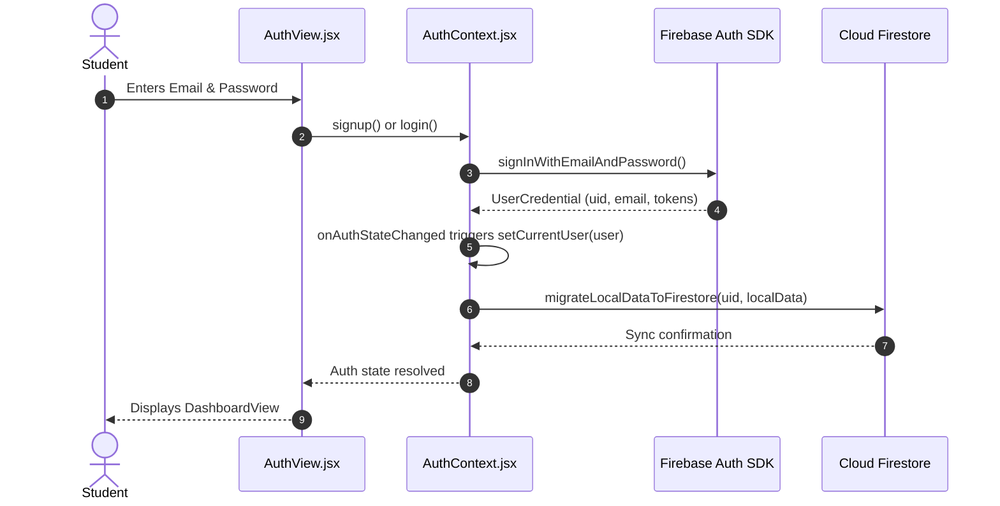
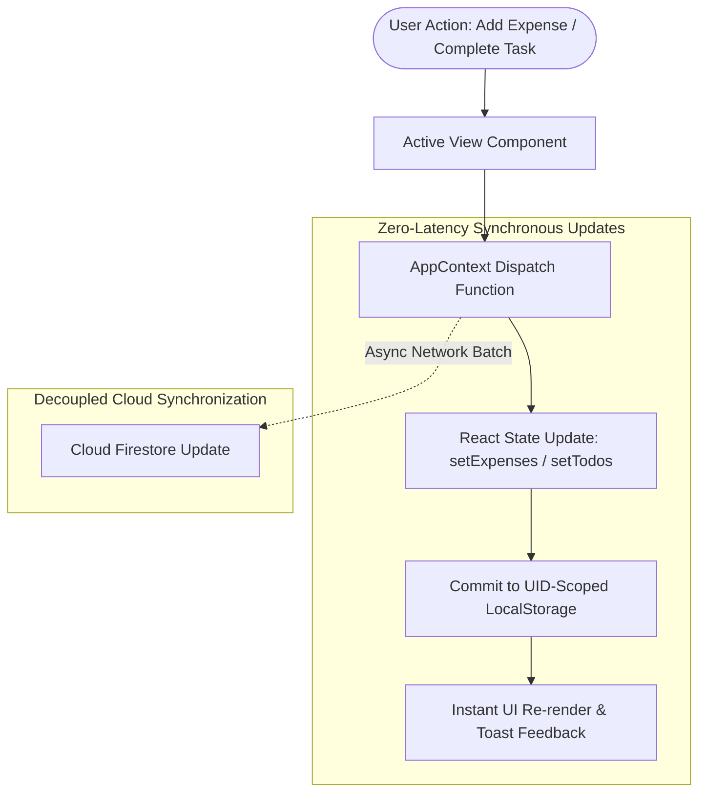
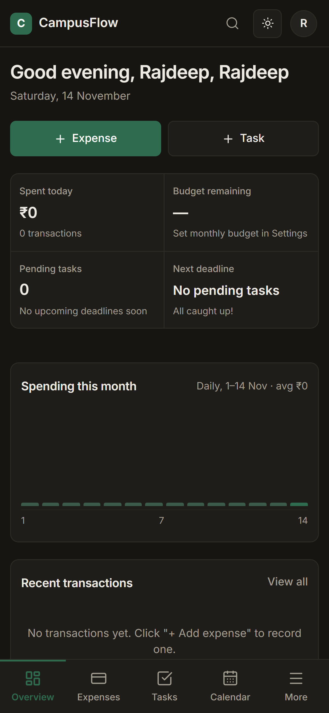
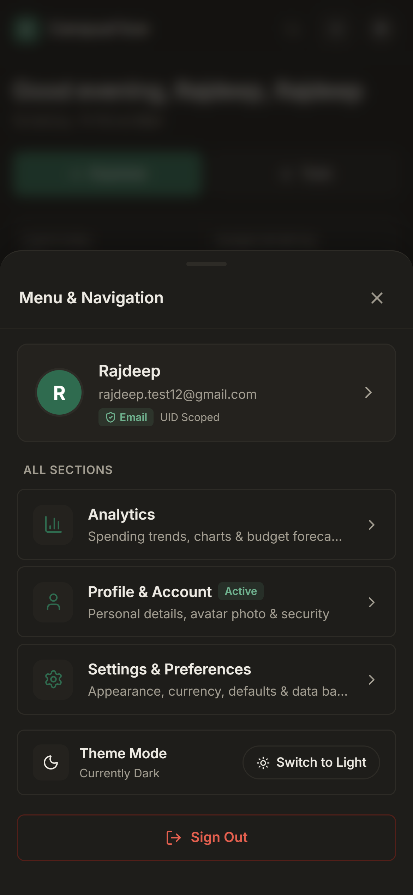
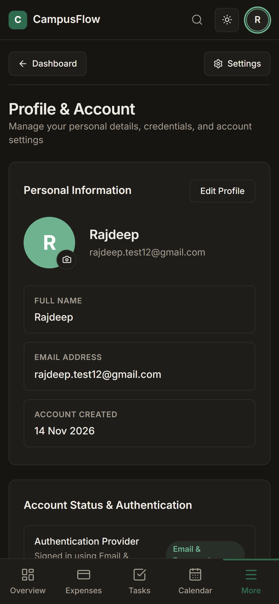
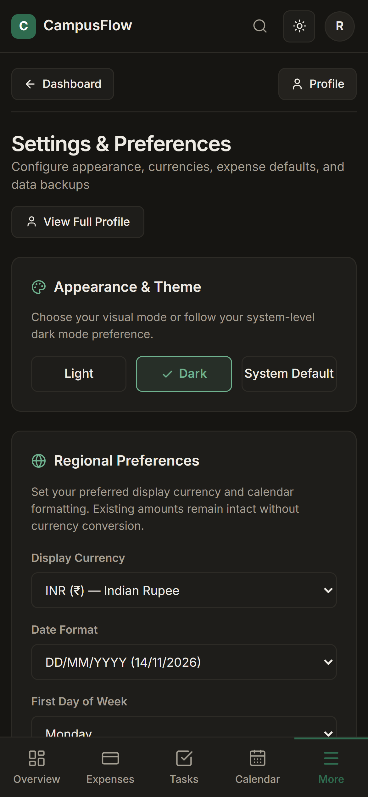

# 🎓 CampusFlow

### **Minimalist Student Expense Tracker, Budget Planner & Personal Task Management System**

[](https://campusflow-sepia.vercel.app)
[](https://rajdeep18-lab.github.io/campusflow/)
[](https://react.dev/)
[](https://vite.dev/)
[](https://tailwindcss.com/)
[](https://firebase.google.com/)
[](LICENSE)

---

## 🔗 Live Deployments & Repository Links

- 🌐 **Primary Production Deployment (Vercel)**: [https://campusflow-sepia.vercel.app](https://campusflow-sepia.vercel.app)
- 🌐 **Alternative Live Mirror (GitHub Pages)**: [https://rajdeep18-lab.github.io/campusflow/](https://rajdeep18-lab.github.io/campusflow/)
- 💻 **Source Code Repository**: [https://github.com/Rajdeep18-lab/campusflow](https://github.com/Rajdeep18-lab/campusflow)
- 📚 **Comprehensive Documentation Hub**:
  - [College Project Academic Report (`docs/PROJECT_REPORT.md`)](docs/PROJECT_REPORT.md)
  - [System Architecture & State Flow (`docs/SYSTEM_ARCHITECTURE.md`)](docs/SYSTEM_ARCHITECTURE.md)
  - [Firebase Integration & Security Rules (`docs/FIREBASE_INTEGRATION.md`)](docs/FIREBASE_INTEGRATION.md)
  - [Complete Feature Specification Inventory (`docs/FEATURES.md`)](docs/FEATURES.md)

---

## 📖 Table of Contents

- [A. Project Introduction](#a-project-introduction)
- [B. Project Objectives](#b-project-objectives)
- [C. Technology Stack](#c-technology-stack)
- [D. Firebase Integration Architecture](#d-firebase-integration-architecture)
- [E. Application Architecture & Data Flow](#e-application-architecture--data-flow)
- [F. Major Application Modules](#f-major-application-modules)
- [G. Monthly PDF Report Generation](#g-monthly-pdf-report-generation)
- [H. Security & Data Management](#h-security--data-management)
- [I. Responsive Design & User Experience](#i-responsive-design--user-experience)
- [J. Visual Showcase & Screenshots](#j-visual-showcase--screenshots)
- [K. Deployment and Live URLs](#k-deployment-and-live-urls)
- [L. Installation and Local Setup Guide](#l-installation-and-local-setup-guide)
- [License & Author](#license--author)

---

## A. Project Introduction

### What is CampusFlow?
**CampusFlow** is an offline-first, client-driven SaaS personal management platform engineered specifically for university and college students. It solves the fragmentation between financial budgeting and academic scheduling by unifying real-time expense tracking, monthly budget enforcement, assignment deadline management, interactive visual calendars, expense analytics, and client-side monthly PDF financial report generation into one responsive web interface.

### Why was it developed?
Students live on fixed, limited allowances (parental stipends, part-time earnings, or scholarships) and operate under strict academic deadlines. Mainstream finance apps target salaried professionals with credit cards, investment portfolios, and invasive SMS scraping requirements. On the other hand, student todo applications ignore financial discipline entirely. Students are left juggling spreadsheets, generic todo lists, and manual notebooks.

### How does CampusFlow solve this?
CampusFlow eliminates context switching with a single intuitive workflow:
1. **Immediate Expense Logging**: Categorize food, books, travel, mess, hostel rent, and recharge in seconds with localized currency support.
2. **Proactive Budget Warnings**: Real-time visual progress bars alert students when they reach 75%, 90%, or 100% of their monthly budget.
3. **Integrated Academic Deadlines**: Track assignments, lab records, and exams with priority badges (High, Medium, Low) and confetti celebrations upon completion.
4. **Offline Resilience with Cloud Sync**: Instant local persistence via `localStorage` paired with cryptographic UID isolation and Firebase cloud synchronization.

---

## B. Project Objectives

- 💰 **Student Expense Tracking**: Enable instantaneous capture of day-to-day expenditures categorized by campus spending habits.
- 🎯 **Monthly Budget Enforcement**: Provide dynamic budget utilization metrics and burn-rate calculations to prevent end-of-month insolvency.
- 📅 **Task & Time Management**: Enable students to organize assignments, project milestones, and exam prep alongside financial timelines.
- 📊 **Expense Analytics**: Deliver clear visual charts (category doughnut charts, monthly trends, weekly spending bars) powered by Chart.js.
- 📄 **Monthly PDF Financial Statements**: Enable one-click client-side generation of professional A4 expense reports using `jsPDF` and `jspdf-autotable`.
- 🔐 **Secure User Authentication**: Provide safe Email/Password and Google sign-in workflows via the Firebase Authentication SDK.
- 👤 **Personalized User Profiles**: Manage profile avatars (Base64 storage), display names, registration metadata, and security settings.
- ⚙️ **Centralized Customization**: Provide theme switching (Light / Dark mode), currency selection (INR ₹, USD $, EUR €, etc.), date formatting, and JSON backup/restore.

---

## C. Technology Stack

### Frontend Core
- **[React 19 (v19.2.8)](https://react.dev/)**: Latest React runtime utilizing functional components, custom hooks, and the Context API.
- **[JavaScript (ES6+)](https://developer.mozilla.org/en-US/docs/Web/JavaScript)**: Clean, modern asynchronous JavaScript modules.
- **[Tailwind CSS (v4.3.3)](https://tailwindcss.com/)**: Modern utility-first CSS framework configured with custom CSS design tokens.
- **[Vite 8 (v8.2.0)](https://vite.dev/)**: High-speed ES module bundler and development server.
- **[Lucide React (v1.28.0)](https://lucide.dev/)**: Lightweight, accessible SVG icon library.

### Backend & Cloud Services
- **[Firebase Authentication (v13.3.0)](https://firebase.google.com/docs/auth)**: Secure user sign-up, sign-in, password reset, and session observer.
- **[Cloud Firestore (v13.3.0)](https://firebase.google.com/docs/firestore)**: Flexible NoSQL cloud database used for cross-device backup and atomic batch synchronization.
- **Firebase Web SDK**: Official modular SDK.

### Utility & Enhancement Libraries
- **HTML5 Web Storage API (`localStorage`)**: UID-scoped local storage for instant offline access.
- **[Chart.js (v4.5.1)](https://www.chartjs.org/) & [react-chartjs-2 (v5.3.1)](https://react-chartjs-2.js.org/)**: Canvas-based interactive data visualizations.
- **[jsPDF (v4.2.1)](https://github.com/parallax/jsPDF) & [jspdf-autotable (v5.0.9)](https://github.com/simonbengtsson/jsPDF-AutoTable)**: Zero-server client-side PDF document assembly.
- **[Canvas Confetti (v1.9.4)](https://github.com/catdad/canvas-confetti)**: Micro-interaction animations for task completion milestones.
- **[vite-plugin-pwa (v1.3.0)](https://vite-pwa-org.netlify.app/)**: Progressive Web Application manifest, offline indicators, and service worker caching.

---

## D. Firebase Integration Architecture

Firebase provides identity management and optional cloud backup while maintaining CampusFlow's offline-first architecture.

### 1. Firebase Services Used
- **Firebase Authentication**: Manages identity lifecycle (Email/Password credentials, Google Sign-in popup, and secure token issuance).
- **Cloud Firestore**: Stores document snapshots of user profiles, budgets, expenses, and tasks organized under a multi-tenant hierarchy.

### 2. Authentication Workflow


- **Session Persistence**: Initialized in `AuthContext.jsx` via `onAuthStateChanged()`. Auth tokens are stored securely in browser IndexedDB, persisting across page reloads and browser restarts.
- **Password Reset**: Calls `sendPasswordResetEmail()` to securely send an out-of-band reset link directly to the student's email.
- **Google OAuth**: One-tap popup integration designed for university and Gmail addresses.

### 3. Cloud Firestore Database Hierarchy
All documents are partitioned under the authenticated student's unique identifier (`uid`):

```
/users/{uid}                              (Root user document: email, createdAt, migratedAt)
  ├── profile/info                        (Name, avatarUrl, theme, isOnboarded)
  ├── settings/budget                     (monthlyBudget, currency, updatedAt)
  ├── expenses/{expenseId}                (id, title, amount, category, date, paymentMethod)
  └── todos/{todoId}                      (id, title, priority, dueDate, completed)
```

### 4. Firestore Security & UID Isolation
Data integrity is maintained using declarative Firestore security rules that verify authentication and enforce ownership:

```javascript
rules_version = '2';
service cloud.firestore {
  match /databases/{database}/documents {
    match /users/{userId}/{document=**} {
      allow read, write: if request.auth != null && request.auth.uid == userId;
    }
  }
}
```

---

## E. Application Architecture & Data Flow

CampusFlow follows a unidirectional data flow pattern powered by React's Context API.



### State Management Separation
- **`AuthContext.jsx`**: Holds identity, session status, user profile metadata, and authentication methods.
- **`AppContext.jsx`**: Manages all functional state: transactions, tasks, budget limits, current view routing (`activePage`), user preferences, and global toast notifications.
- **LocalStorage UID Partitioning**: Ensures multiple students using the same browser profile never see each other's financial or task data.

---

## F. Major Application Modules

### 1. Overview / Dashboard (`DashboardView.jsx`)
The command center displaying month-to-date total spend, remaining budget, burn-rate metrics, dynamic budget progress bars, pending urgent tasks, and quick navigation shortcuts.

### 2. Expenses Management (`ExpenseView.jsx` & `QuickAddExpenseModal.jsx`)
Full-featured expense tracker with search filtering, multi-category selection, sorting by amount/date, and inline editing or deletion of transactions.

### 3. Budget Tracking (`BudgetModal.jsx`)
Enables students to set a realistic monthly spending limit. Features progressive visual alerts that transition from forest green to amber and warning crimson as thresholds are approached.

### 4. Task / Todo Management (`TodoView.jsx` & `TaskModal.jsx`)
Academic task manager supporting deadline dates, priority classifications (*High*, *Medium*, *Low*), filter tabs (*All*, *Today*, *Pending*, *Completed*), and confetti rewards.

### 5. Interactive Calendar View (`CalendarView.jsx`)
Monthly visual grid mapping daily expense sums and task deadlines onto dates, complemented by a day-detail flyout inspector.

### 6. Expense Analytics (`AnalyticsView.jsx`)
Visual intelligence dashboard rendering category distribution doughnut charts, weekly expense histograms, and automated savings recommendations.

### 7. Monthly PDF Financial Reports (`pdfGenerator.js` & `DownloadReportModal.jsx`)
Client-side PDF compilation producing branded, printable A4 statements summarizing monthly expenses, budget utilization, category breakdowns, and transaction ledgers.

### 8. User Profile Management (`ProfileView.jsx`)
Identity management page allowing students to view account credentials, update display names, customize profile avatars (Base64), inspect creation timestamps, and change passwords.

### 9. Application Settings (`SettingsView.jsx`)
Central hub for localization preferences (currency, date format, starting day of week), visual theme mode (Light, Dark, System), notification toggles, and JSON backup/restore.

### 10. Authentication System (`AuthView.jsx` & `AuthContext.jsx`)
Complete credential management interface supporting registration, sign-in, password reset, and session recovery with user-friendly error translations.

### 11. Responsive Navigation System
- **Desktop Sidebar (`Sidebar.jsx`)**: 232px persistent navigation bar with active state pills, quick "+ Expense" button, and user status footer.
- **Mobile Bottom Navigation (`BottomNav.jsx`)**: Fixed 5-tab bar (*Overview*, *Expenses*, *Tasks*, *Calendar*, *More*) with safe-area padding.
- **Mobile More Drawer (`MobileMoreDrawer.jsx`)**: Slide-up bottom sheet granting mobile access to Analytics, Profile, Settings, Account info, and Logout.

### 12. Notification and Reminder System (`NotificationService.js`)
Native Web Notifications API scheduler dispatching reminders for daily expense logging (8:00 PM), upcoming task deadlines, and budget threshold warnings, paired with synthetic audio feedback via the Web Audio API.

### 13. Data Backup and Restore
Export full user data into a portable timestamped JSON file (`campusflow_backup_YYYY-MM-DD.json`) or import an existing backup with automatic schema verification.

---

## G. Monthly PDF Report Generation

CampusFlow includes a dedicated client-side PDF generation engine implemented in `src/utils/pdfGenerator.js` using `jsPDF` and `jspdf-autotable`.

```mermaid
graph LR
    Input[User selects Month & Year] --> Filter[Filter Expenses by YYYY-MM]
    Filter --> Metrics[Compute Total Spent, Budget, Remaining %]
    Metrics --> CategorySum[Aggregate Category Breakdown]
    CategorySum --> jsPDFEngine[Initialize jsPDF A4 Document]
    jsPDFEngine --> Header[Render Forest Green Branded Header]
    Header --> SummaryCards[Draw 4 Metric Stat Boxes]
    SummaryCards --> CategoryTable[Render AutoTable: Category Summary]
    CategoryTable --> LedgerTable[Render AutoTable: Full Transaction Log]
    LedgerTable --> Download[doc.save: campusflow_report_YYYY_MM.pdf]
```



### Key PDF Features
- **Zero Server Overhead**: The PDF is assembled entirely in the client's browser, guaranteeing data privacy.
- **A4 Document Structure**:
  - Forest Green Header bar (`#1F4D3A`) with CampusFlow branding.
  - Student details: Full Name, Registered Email, Generation Timestamp.
  - 4 Summary Cards: Total Spent, Monthly Budget, Remaining Budget, Utilization %.
  - Category Breakdown Table: Categorical totals, counts, and percentages.
  - Granular Transaction Table: Full chronological ledger with alternating row striping (`#F7F5F0`).
  - Automatic page numbering (`Page X of Y`).

---

## H. Security & Data Management

1. **Cryptographic UID Isolation**: LocalStorage keys are explicitly prefixed with the active Firebase `uid` (`campusflow_${uid}_*`).
2. **Session Security**: Authentication tokens are securely managed by the Firebase Auth SDK in browser IndexedDB.
3. **No Hardcoded Secrets**: All API keys in `.env` are client identifiers; data protection is enforced via Firestore security rules.
4. **User-Controlled Data**: Students can export their full data profile to JSON or delete their account and associated records permanently at any time.

---

## I. Responsive Design & User Experience

CampusFlow incorporates a **Warm Neutral + Forest Green** design system.

### Color Tokens

| Token | Hex Value | Usage |
| :--- | :--- | :--- |
| **Forest Green (Primary)** | `#1F4D3A` | Brand accent, primary buttons, active nav pills |
| **Forest Green Light** | `#E8F0EC` | Active pill background, selected badge fills |
| **Canvas Background (Light)**| `#FBF9F4` | Clean paper-like light application background |
| **Card Surface (Light)** | `#FFFFFF` | Primary card container surface |
| **Border Neutral** | `#E4E0D6` | Subtle dividers and component borders |
| **Canvas Background (Dark)** | `#121815` | Deep slate dark theme canvas |
| **Card Surface (Dark)** | `#1B2420` | Elevated dark card surface |

### Multi-Device Adaptability
- **Desktop (`≥ 768px`)**: Fixed 232px left sidebar, multi-column dashboard grid, centered modal overlays.
- **Mobile (`< 768px`)**: Sticky top header with active avatar link, fixed 5-tab bottom navigation, and a bottom sheet drawer for secondary pages.

---

## J. Visual Showcase & Screenshots

### Desktop Command Center

*Figure 1: Desktop Overview showcasing financial metrics, monthly budget progress bar, and academic task stream.*

### Mobile Interface Experience (Tested on 390 × 844)
| Mobile Overview | Mobile More Drawer |
| :---: | :---: |
|  |  |
| *Figure 2: Mobile Dashboard View* | *Figure 3: 5th-Tab Mobile More Drawer* |

| Mobile Profile | Mobile Settings |
| :---: | :---: |
|  |  |
| *Figure 4: Mobile Profile Page* | *Figure 5: Mobile Application Settings* |

---

## K. Deployment and Live URLs

CampusFlow is deployed across modern cloud hosting infrastructures:

- 🚀 **Primary Production (Vercel)**: [https://campusflow-sepia.vercel.app](https://campusflow-sepia.vercel.app)
  - Configured with `vercel.json` for SPA rewrites:
    ```json
    {
      "rewrites": [{ "source": "/(.*)", "destination": "/index.html" }]
    }
    ```
- 🌐 **Mirror Deployment (GitHub Pages)**: [https://rajdeep18-lab.github.io/campusflow/](https://rajdeep18-lab.github.io/campusflow/)
- 📦 **Git Remote**: `origin https://github.com/Rajdeep18-lab/campusflow.git`

---

## L. Installation and Local Setup Guide

Follow these steps to run CampusFlow locally:

### 1. Prerequisites
- **Node.js**: `v18.x` or `v20.x` installed ([https://nodejs.org](https://nodejs.org/))
- **Package Manager**: `npm` (comes with Node) or `yarn` / `pnpm`
- **Git**: Installed on your system

### 2. Clone the Repository
```bash
git clone https://github.com/Rajdeep18-lab/campusflow.git
cd campusflow
```

### 3. Install Dependencies
```bash
npm install
```

### 4. Configure Environment Variables
Copy `.env.example` to create your local `.env`:
```bash
cp .env.example .env
```
Populate `.env` with your Firebase credentials (or leave defaults for local fallback mode):
```env
VITE_FIREBASE_API_KEY=your_actual_api_key_here
VITE_FIREBASE_AUTH_DOMAIN=your_project_id.firebaseapp.com
VITE_FIREBASE_PROJECT_ID=your_project_id
VITE_FIREBASE_STORAGE_BUCKET=your_project_id.appspot.com
VITE_FIREBASE_MESSAGING_SENDER_ID=your_messaging_sender_id
VITE_FIREBASE_APP_ID=your_app_id
VITE_FIREBASE_MEASUREMENT_ID=your_measurement_id
```

### 5. Start the Development Server
```bash
npm run dev
```
Open your browser and navigate to `http://localhost:5173`.

### 6. Build for Production
```bash
npm run build
```
The optimized production bundle is compiled into the `dist/` directory.

### 7. Preview the Production Build
```bash
npm run preview
```

---

## License & Author

- **Author**: [Rajdeep18-lab](https://github.com/Rajdeep18-lab)
- **License**: This project is licensed under the [MIT License](LICENSE) – feel free to use, modify, and build upon this software for educational and personal projects.
