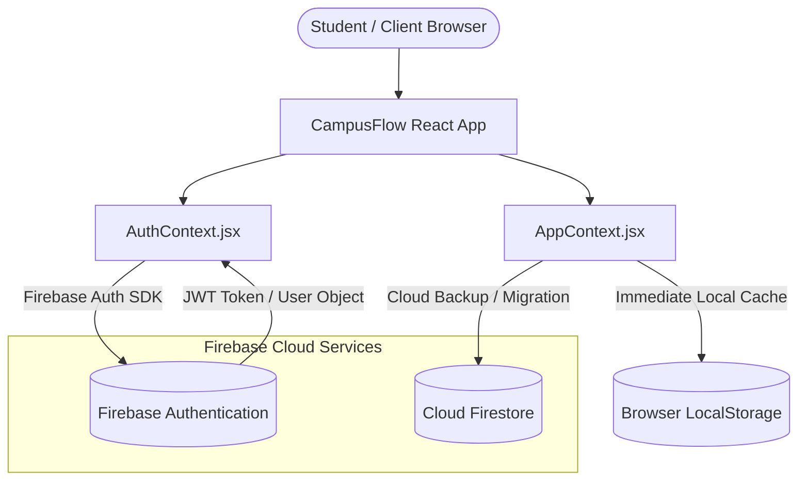
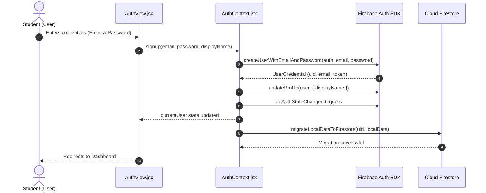

# CampusFlow – Firebase Integration Architecture & Guide

This document provides a comprehensive technical overview of the Firebase integration in **CampusFlow**. It details the architectural role of Firebase, client configuration, authentication workflows, Firestore data schemas, user isolation mechanisms, security rules, and offline fallback strategies.

---

## Table of Contents

1. [Architectural Role of Firebase](#1-architectural-role-of-firebase)
2. [Firebase Configuration & Environment Setup](#2-firebase-configuration--environment-setup)
3. [Authentication Architecture & Workflows](#3-authentication-architecture--workflows)
4. [Cloud Firestore Database Architecture](#4-cloud-firestore-database-architecture)
5. [Data Migration Engine (`migrateLocalDataToFirestore`)](#5-data-migration-engine-migratelocaldatatofirestore)
6. [Multi-Tenant UID Data Isolation & Security](#6-multi-tenant-uid-data-isolation--security)
7. [Recommended Production Firestore Security Rules](#7-recommended-production-firestore-security-rules)
8. [Offline Resilience & Graceful Fallback Strategy](#8-offline-resilience--graceful-fallback-strategy)
9. [Error Handling & User Feedback](#9-error-handling--user-feedback)

---

## 1. Architectural Role of Firebase

CampusFlow utilizes **Firebase (v13.3.0 SDK)** as its backend cloud infrastructure while upholding an **offline-first** design philosophy. Rather than creating high-latency dependencies on external cloud APIs for every button click, CampusFlow integrates Firebase to provide:

1. **Identity & Access Management (IAM)**: Decentralized, secure authentication supporting Email/Password accounts, Google OAuth 2.0 single sign-on, and encrypted session management.
2. **Cloud Backup & Multi-Device Sync**: Optional cloud persistence in Cloud Firestore so students can log into a new laptop, tablet, or phone and instantly restore their expense history, budget ceilings, and academic tasks.
3. **Multi-Tenant Data Privacy**: Strict user data separation where every document path is keyed under the authenticated user's unique Firebase identifier (`uid`).



---

## 2. Firebase Configuration & Environment Setup

Firebase is initialized in `src/firebase/config.js` using Vite environment variables.

### 2.1 Configuration Keys (`.env`)

To connect a Firebase project, configure the following keys in your `.env` file or hosting environment (e.g., Vercel Project Settings):

```env
VITE_FIREBASE_API_KEY=your_actual_api_key_here
VITE_FIREBASE_AUTH_DOMAIN=your_project_id.firebaseapp.com
VITE_FIREBASE_PROJECT_ID=your_project_id
VITE_FIREBASE_STORAGE_BUCKET=your_project_id.appspot.com
VITE_FIREBASE_MESSAGING_SENDER_ID=your_messaging_sender_id
VITE_FIREBASE_APP_ID=your_app_id
VITE_FIREBASE_MEASUREMENT_ID=your_measurement_id
```

### 2.2 Graceful Initialization & Demo Mode Guard

To ensure that the application never crashes during development, offline demos, or automated grading without credentials, `src/firebase/config.js` includes an automatic fallback check:

```javascript
// src/firebase/config.js
export const isFirebaseConfigured = Boolean(
  firebaseConfig.apiKey &&
  firebaseConfig.projectId &&
  firebaseConfig.apiKey !== 'your_api_key_here'
);

let app, auth, db;

if (isFirebaseConfigured) {
  app = !getApps().length ? initializeApp(firebaseConfig) : getApp();
  auth = getAuth(app);
  db = getFirestore(app);
} else {
  console.warn('[CampusFlow] Firebase environment variables not detected or incomplete.');
  // Initialize safe placeholder app to prevent runtime crashes on import
  try {
    app = !getApps().length ? initializeApp({
      apiKey: 'dummy-api-key',
      authDomain: 'localhost',
      projectId: 'campusflow-demo',
      appId: '1:123456789:web:abcdef',
    }) : getApp();
    auth = getAuth(app);
    db = getFirestore(app);
  } catch (e) {
    console.error('[CampusFlow] Fallback initialization error:', e);
  }
}
```

---

## 3. Authentication Architecture & Workflows

Authentication is managed via `src/context/AuthContext.jsx` using the Firebase Auth modular SDK (`firebase/auth`).



### 3.1 Implemented Authentication Methods

1. **Email and Password Registration (`signup`)**:
   - Calls `createUserWithEmailAndPassword(auth, email, password)`.
   - Upon successful account creation, immediately updates the Firebase profile with the student's full name via `updateProfile()`.
2. **Email and Password Sign-in (`login`)**:
   - Calls `signInWithEmailAndPassword(auth, email, password)`.
   - Returns the authenticated user object.
3. **Google Sign-in / Single Sign-On (`handleGoogleClick`)**:
   - Designed for seamless OAuth 2.0 popup authentication via `GoogleAuthProvider`.
   - When Google provider is enabled in Firebase Console, students can sign in with their university Google Workspace or personal Gmail.
4. **Password Reset (`resetPassword`)**:
   - Calls `sendPasswordResetEmail(auth, email)`.
   - Firebase securely dispatches a time-limited, signed password reset link directly to the student's email inbox.
5. **Profile Updating (`updateUserProfile`)**:
   - Updates `displayName` and `photoURL` directly on the authenticated Firebase user instance.
6. **Password Update (`updateUserPassword`)**:
   - Updates the password for currently authenticated users via `updatePassword(auth.currentUser, newPassword)`.
7. **Account Deletion (`deleteUserAccount`)**:
   - Permanently deletes the user record from Firebase Auth using `deleteUser(auth.currentUser)`.
8. **Session Persistence & Observer (`onAuthStateChanged`)**:
   - Attaches a persistent listener on mount:
     ```javascript
     const unsubscribe = onAuthStateChanged(auth, (user) => {
       setCurrentUser(user);
       setLoading(false);
     });
     ```
   - Automatically re-authenticates the user across browser refreshes, tabs, and sessions using secure IndexedDB token storage.

---

## 4. Cloud Firestore Database Architecture

CampusFlow uses Cloud Firestore as a document-oriented NoSQL database. All user documents are strictly compartmentalized under a root `/users/{uid}` hierarchy.

### 4.1 Collection & Document Hierarchy

```
/users/{uid}                                    (Root User Document)
  ├── profile/info                              (Subcollection: User Profile Details)
  ├── settings/budget                           (Subcollection: Monthly Budget & Settings)
  ├── expenses/{expenseId}                      (Subcollection: Individual Expense Documents)
  └── todos/{todoId}                            (Subcollection: Individual Task Documents)
```

### 4.2 Document Schema Specifications

#### 1. Root User Document: `/users/{uid}`
| Field | Type | Description |
| :--- | :--- | :--- |
| `createdAt` | Timestamp / ServerTimestamp | Account creation date |
| `lastActive` | Timestamp / ServerTimestamp | Last recorded session activity |
| `email` | String | User's registered email |
| `migratedFromLocal` | Boolean | Flag indicating whether local storage data has been synchronized |
| `migratedAt` | Timestamp / ServerTimestamp | Timestamp when data was first uploaded to Firestore |

#### 2. Profile Subcollection: `/users/{uid}/profile/info`
| Field | Type | Description |
| :--- | :--- | :--- |
| `name` | String | Student's full name or display name |
| `avatarUrl` | String (URL or Base64) | Profile image reference |
| `theme` | String | User's selected theme (`'light'`, `'dark'`, `'system'`) |
| `isOnboarded` | Boolean | Whether user has completed the welcome walkthrough |
| `updatedAt` | Timestamp / ServerTimestamp | Last profile modification timestamp |

#### 3. Settings Subcollection: `/users/{uid}/settings/budget`
| Field | Type | Description |
| :--- | :--- | :--- |
| `monthlyBudget` | Number | Configured monthly spending limit (e.g., `5000`) |
| `currency` | String | Currency identifier (e.g., `'INR'`, `'USD'`) |
| `updatedAt` | Timestamp / ServerTimestamp | Last budget update timestamp |

#### 4. Expenses Subcollection: `/users/{uid}/expenses/{expenseId}`
| Field | Type | Description |
| :--- | :--- | :--- |
| `id` | String | Unique UUID / timestamp identifier |
| `title` | String | Name of expense / merchant (e.g., `"Mess Fees"`) |
| `amount` | Number | Monetary cost (e.g., `2400.00`) |
| `category` | String | Categorization (e.g., `"Food"`, `"Books"`, `"Hostel"`) |
| `date` | String | Transaction date in ISO format (`"YYYY-MM-DD"`) |
| `paymentMethod` | String | Method used (`"UPI"`, `"Cash"`, `"Card"`) |
| `notes` | String | Optional notes or co-payer remarks |
| `createdAt` | Timestamp / String | Record creation timestamp |
| `updatedAt` | Timestamp / ServerTimestamp | Last edit timestamp |

#### 5. Todos Subcollection: `/users/{uid}/todos/{todoId}`
| Field | Type | Description |
| :--- | :--- | :--- |
| `id` | String | Unique task UUID |
| `title` | String | Task description (e.g., `"Submit Physics Lab Report"`) |
| `priority` | String | Urgency level: `"High"`, `"Medium"`, `"Low"` |
| `dueDate` | String | Deadline date (`"YYYY-MM-DD"`) |
| `completed` | Boolean | Completion status (`true` / `false`) |
| `completedAt` | String / Null | Completion timestamp |
| `createdAt` | Timestamp / String | Creation timestamp |
| `updatedAt` | Timestamp / ServerTimestamp | Last modification timestamp |

---

## 5. Data Migration Engine (`migrateLocalDataToFirestore`)

In `src/firebase/firestore.js`, CampusFlow implements an atomic batch migration function that transfers existing offline LocalStorage data to Cloud Firestore as soon as a user signs up or logs in.

### 5.1 Atomic Batch Write Protection
To prevent partial network failures or corrupted synchronization, all documents are written in an atomic Firestore batch:

```javascript
// src/firebase/firestore.js
export const migrateLocalDataToFirestore = async (uid, localData = {}) => {
  if (!isFirebaseConfigured || !db || !uid) return { success: false, reason: 'unconfigured' };

  try {
    const userDocRef = doc(db, 'users', uid);
    const userDocSnap = await getDoc(userDocRef);

    // Guard: Prevent redundant migrations
    if (userDocSnap.exists() && userDocSnap.data()?.migratedFromLocal) {
      return { success: true, alreadyMigrated: true };
    }

    const batch = writeBatch(db);

    // 1. Profile document
    if (localData.profile) {
      const profileRef = doc(db, 'users', uid, 'profile', 'info');
      batch.set(profileRef, { ...localData.profile, updatedAt: serverTimestamp() }, { merge: true });
    }

    // 2. Budget document
    if (typeof localData.monthlyBudget === 'number') {
      const budgetRef = doc(db, 'users', uid, 'settings', 'budget');
      batch.set(budgetRef, { monthlyBudget: localData.monthlyBudget, updatedAt: serverTimestamp() }, { merge: true });
    }

    // 3. Expenses subcollection
    if (Array.isArray(localData.expenses)) {
      localData.expenses.forEach(exp => {
        if (!exp.id) return;
        const expRef = doc(db, 'users', uid, 'expenses', exp.id);
        batch.set(expRef, { ...exp, updatedAt: serverTimestamp() }, { merge: true });
      });
    }

    // 4. Tasks subcollection
    if (Array.isArray(localData.todos)) {
      localData.todos.forEach(todo => {
        if (!todo.id) return;
        const todoRef = doc(db, 'users', uid, 'todos', todo.id);
        batch.set(todoRef, { ...todo, updatedAt: serverTimestamp() }, { merge: true });
      });
    }

    // 5. Finalize root user doc with migration flag
    batch.set(userDocRef, {
      migratedFromLocal: true,
      migratedAt: serverTimestamp(),
      lastActive: serverTimestamp(),
    }, { merge: true });

    await batch.commit();
    return { success: true, alreadyMigrated: false };
  } catch (error) {
    console.error('[CampusFlow] Error migrating data to Firestore:', error);
    return { success: false, error };
  }
};
```

---

## 6. Multi-Tenant UID Data Isolation & Security

CampusFlow enforces strict data isolation at two concentric levels:

### 6.1 Client-Side LocalStorage Scoping
LocalStorage is shared across an origin (`domain:port`). Without UID scoping, a second user logging in on the same browser would immediately view the previous student's financial records.

CampusFlow solves this by dynamically partitioning every storage key with the authenticated user's Firebase UID (`src/context/AppContext.jsx`):

```javascript
const getUserStorageKeys = (uid) => {
  if (!uid) {
    return {
      profile: 'campusflow_profile_v2',
      expenses: 'campusflow_expenses_v2',
      budget: 'campusflow_budget_v2',
      todos: 'campusflow_todos_v2',
      categories: 'campusflow_categories_v2',
      preferences: 'campusflow_preferences_v2',
      migrated: 'campusflow_migrated_v2',
    };
  }
  return {
    profile: `campusflow_${uid}_profile`,
    expenses: `campusflow_${uid}_expenses`,
    budget: `campusflow_${uid}_budget`,
    todos: `campusflow_${uid}_todos`,
    categories: `campusflow_${uid}_categories`,
    preferences: `campusflow_${uid}_preferences`,
    migrated: `campusflow_${uid}_migrated`,
  };
};
```

When user `A` signs out and user `B` signs in, `currentUid` updates from `UID_A` to `UID_B`. AppContext flushes its in-memory state and reloads strictly from `campusflow_UID_B_*`. User A's data is impossible for User B to access.

---

## 7. Recommended Production Firestore Security Rules

To ensure complete server-side security in the Firebase Cloud, the following production security rules (`firestore.rules`) must be deployed in the Firebase Console:

```javascript
rules_version = '2';
service cloud.firestore {
  match /databases/{database}/documents {

    // Helper functions
    function isAuthenticated() {
      return request.auth != null;
    }
    
    function isOwner(userId) {
      return isAuthenticated() && request.auth.uid == userId;
    }

    // Root user document
    match /users/{userId} {
      allow read, write: if isOwner(userId);

      // Profile subcollection
      match /profile/{document=**} {
        allow read, write: if isOwner(userId);
      }

      // Settings subcollection
      match /settings/{document=**} {
        allow read, write: if isOwner(userId);
      }

      // Expenses subcollection
      match /expenses/{expenseId} {
        allow read, write: if isOwner(userId);
      }

      // Todos subcollection
      match /todos/{todoId} {
        allow read, write: if isOwner(userId);
      }
    }

    // Default deny all other paths
    match /{document=**} {
      allow read, write: false;
    }
  }
}
```

### Rule Explanation
1. `isAuthenticated()`: Verifies that the incoming request contains a valid, unexpired Firebase Auth JWT token.
2. `isOwner(userId)`: Verifies that the requesting user's `auth.uid` strictly matches the `{userId}` parameter in the document path.
3. Users cannot read, query, update, or delete any record residing in another student's `/users/{otherUid}` tree.
4. Catch-all rule (`match /{document=**}`) rejects any unmapped root collections.

---

## 8. Offline Resilience & Graceful Fallback Strategy

CampusFlow ensures an uninterrupted user experience even under hostile network conditions or missing API credentials:

1. **Zero-Block Initialization**: If `isFirebaseConfigured` is `false`, the app does not display a blank screen or fail to mount. It automatically switches to LocalStorage mode, allowing full expense tracking, budget management, and PDF generation.
2. **Immediate Local Updates**: Every expense and task mutation immediately writes to LocalStorage. If the student loses internet connection on campus Wi-Fi, no data is lost.
3. **Optimistic UI Updates**: React Context updates local state synchronously, guaranteeing 60fps UI responsiveness without waiting for Firestore round-trips.

---

## 9. Error Handling & User Feedback

Firebase authentication and database error codes are mapped into human-readable, student-friendly messages using `src/utils/authUtils.js`:

| Firebase Error Code | User-Friendly Message |
| :--- | :--- |
| `auth/invalid-email` | Please enter a valid email address. |
| `auth/user-not-found` | No account found with this email. Please sign up first. |
| `auth/wrong-password` | Incorrect password. Please try again or reset your password. |
| `auth/email-already-in-use` | An account already exists with this email address. |
| `auth/weak-password` | Password is too weak. Please use at least 6 characters. |
| `auth/network-request-failed` | Network error. Please check your internet connection. |
| `auth/too-many-requests` | Too many failed attempts. Please try again in a few minutes. |

All error states are displayed directly in the authentication card with clear dismiss options.
