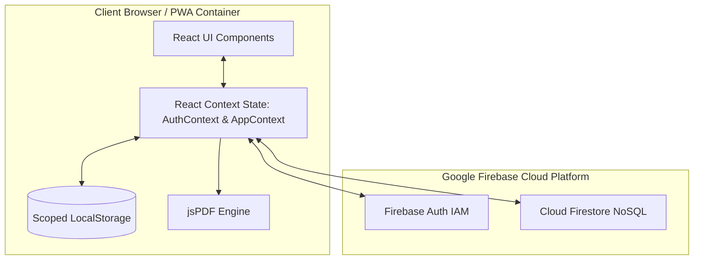
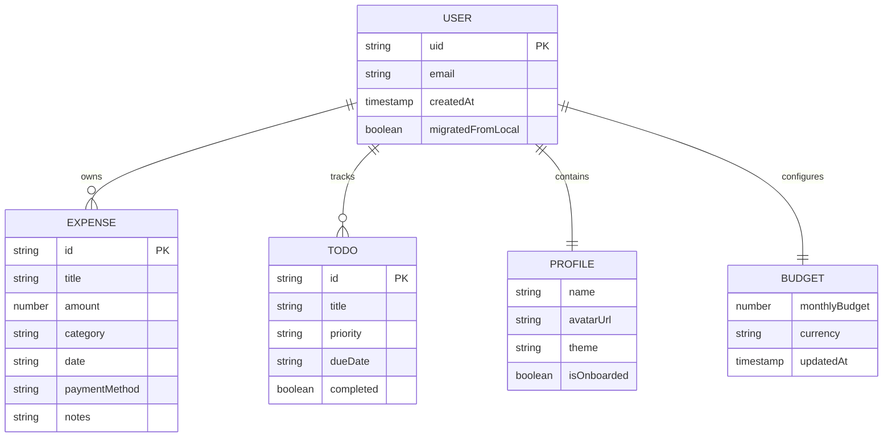
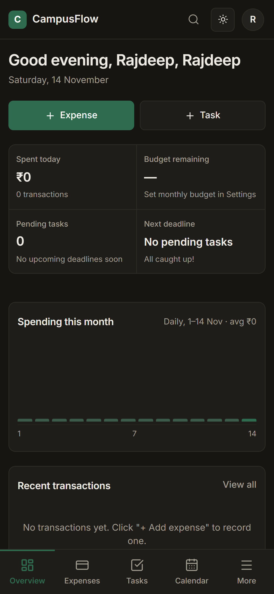
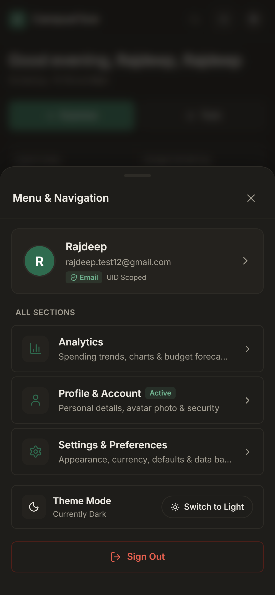
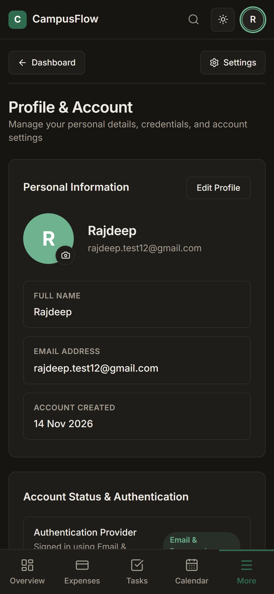
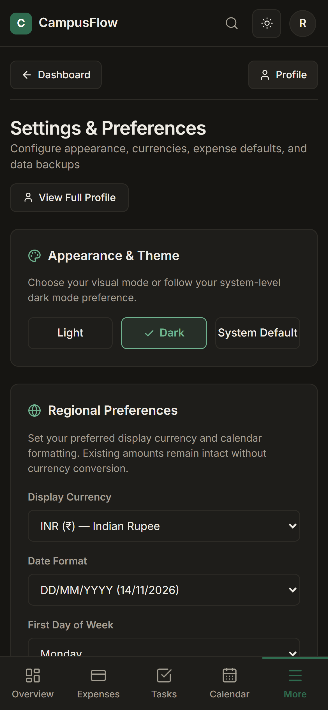

# CampusFlow: An Offline-First Student Expense Tracking and Academic Personal Management System

### A Comprehensive Academic Project Report

**Project Title**: CampusFlow – Student Expense & Personal Management Application  
**Author / Repository Owner**: [Rajdeep18-lab](https://github.com/Rajdeep18-lab)  
**Repository**: [https://github.com/Rajdeep18-lab/campusflow](https://github.com/Rajdeep18-lab/campusflow)  
**Live Production URL**: [https://campusflow-sepia.vercel.app](https://campusflow-sepia.vercel.app)  
**Version**: 2.1 (Production Release)  

---

## Abstract

College students frequently experience financial vulnerability, irregular cash flows, and time-management challenges. Traditional personal finance applications are typically tailored for salaried professionals, demanding complex banking integrations, recurring subscription fees, and continuous internet connectivity while failing to integrate academic milestones. Conversely, conventional student task managers neglect budgetary constraints.

**CampusFlow** is an offline-first single-page web application (SPA) and Progressive Web Application (PWA) developed to bridge the gap between financial discipline and academic task tracking. Built using **React 19**, **Vite 8**, **Tailwind CSS v4**, and **Firebase (Authentication & Cloud Firestore)**, CampusFlow unifies real-time expense logging, monthly budget enforcement, deadline management, interactive calendar timelines, expense analytics, and client-side monthly PDF financial report generation into one responsive interface. User data is partitioned by authenticated Firebase Unique Identifiers (`uid`) within both `localStorage` and Firestore, ensuring complete multi-tenant privacy. This report provides an in-depth academic exposition of the problem domain, architecture, data schemas, verification methodologies, and system performance.

---

## Chapter 1: Introduction & Problem Statement

### 1.1 Background and Motivation
Higher education presents students with financial autonomy for the first time. Away from home, students must manage finite monthly allowances across competing demands such as hostel rent, mess fees, academic textbooks, daily commuting, and social discretionary spending. However, cognitive friction, lack of specialized tools, and cumbersome interfaces frequently lead to mid-month budget exhaustion.

### 1.2 Problem Statement
Existing software solutions suffer from critical shortcomings:
1. **Target Audience Mismatch**: Mainstream finance applications (e.g., Mint, Walnut, YNAB) assume fixed salaried incomes and require automated SMS/bank scraping permissions that compromise user privacy.
2. **Context Switching**: Students are forced to maintain disparate applications: a spreadsheet or mobile app for expenses, a separate calendar for exams, and a generic to-do list for lab assignments.
3. **Connectivity Barriers**: Campus Wi-Fi environments often suffer from dead zones and intermittent connectivity, causing network-dependent applications to freeze or drop unsaved entries.
4. **Intrusive Data Policies**: Free financial applications frequently monetize user transaction telemetry.

### 1.3 The Proposed Solution: CampusFlow
CampusFlow addresses these limitations by providing a unified, student-centric productivity hub that operates with an **offline-first** paradigm. Every mutation is instantaneously persisted locally to provide zero-latency responsiveness, while optional cloud synchronization via Firebase guarantees multi-device availability.

---

## Chapter 2: Project Objectives & Scope

### 2.1 General Objective
To design, implement, test, and deploy a responsive, privacy-preserving, offline-first personal management system specifically tailored to the financial and academic lifestyles of college students.

### 2.2 Specific Goals
- **Expense Tracking**: Enable instantaneous recording of expenditures categorized under student-relevant domains (Food, Mess, Books, Travel, Hostel, Entertainment).
- **Budgetary Alerts**: Provide dynamic visualization of monthly budget consumption with multi-stage warning thresholds (75%, 90%, 100%).
- **Academic Task Scheduling**: Provide task management with deadline scheduling, priority rankings (High, Medium, Low), and instant status filters.
- **Calendar Visualization**: Integrate daily financial burns and task due dates onto a unified monthly calendar grid.
- **Visual Analytics**: Generate intuitive expense distribution charts and spending trends using Chart.js.
- **Monthly PDF Reporting**: Implement client-side generation of A4 financial statements using `jsPDF` and `jspdf-autotable`.
- **Identity & Data Isolation**: Provide secure email/password and Google authentication with cryptographic UID isolation across client and cloud storage.

### 2.3 Scope & Delimitations
- **Scope**: Individual personal budgeting, academic task tracking, client-side PDF statements, PWA installability, and cloud backup.
- **Delimitations**: The initial release does not process direct peer-to-peer bank transfers, UPI payment gateway settlements, or automated SMS scraping.

---

## Chapter 3: Literature Survey & Market Comparison

A comparative evaluation of existing solutions was conducted to benchmark CampusFlow's functional contributions.

| Feature / Metric | Splitwise | Walnut / MoneyView | Notion / Spreadsheets | **CampusFlow 2.1** |
| :--- | :--- | :--- | :--- | :--- |
| **Primary Focus** | Group Bill Splitting | Bank/SMS Tracking | Generic Database | **Student Expense & Task Hub** |
| **Integrated Todo/Tasks**| No | No | Custom Setup Required | **Native High/Med/Low Tasks** |
| **Offline Functionality**| Limited | Degraded | Poor / Requires Sync | **100% Offline-First (LocalStorage)** |
| **Privacy / SMS Scraping**| Moderate | Invasive SMS Access | High | **100% Private (No SMS Scraping)** |
| **Monthly PDF Reports** | Paid / Export only | No PDF Statements | Complex Export | **Native Branded A4 PDF Generator** |
| **Design System** | Generic Corporate | Cluttered Ad-heavy | Blank Canvas | **Warm Neutral + Forest Green** |
| **Mobile Web Navigation**| Standard Tab Bar | Mobile Only | Complex Tree | **5-Tab Bar + More Bottom Sheet** |

---

## Chapter 4: System Requirements Analysis

### 4.1 Software Requirements
- **Runtime Environment**: Modern Web Standards compliant browser (Google Chrome 90+, Mozilla Firefox 88+, Safari 14+, Microsoft Edge 90+).
- **Frontend Stack**: React 19.2.8, Vite 8.2.0, Tailwind CSS 4.3.3, Lucide React 1.28.0.
- **Data & Cloud Services**: Firebase Authentication 13.3.0, Cloud Firestore 13.3.0.
- **Client Libraries**: `jspdf` 4.2.1, `jspdf-autotable` 5.0.9, `chart.js` 4.5.1, `react-chartjs-2` 5.3.1, `canvas-confetti` 1.9.4.
- **Development Tooling**: Node.js 18.x or 20.x, npm / yarn, Git.

### 4.2 Hardware Requirements
- **Client Device**: Desktop, Laptop, Tablet, or Smartphone with minimum 1GB RAM and modern CPU.
- **Display Resolution**: Fully responsive from 320 × 568 (iPhone SE) to 1920 × 1080 (Desktop Full HD) and 4K displays.
- **Storage**: < 10MB local browser storage for client assets and cached records.

---

## Chapter 5: System Architecture & Design

### 5.1 Architecture Overview
CampusFlow adopts a modular **Single Page Application (SPA)** layered architecture consisting of:
1. **User Interface / Presentation Layer**: React 19 functional components utilizing Tailwind CSS utility design tokens.
2. **State Management Layer**: React Context API (`AuthContext` and `AppContext`) providing predictable unidirectional data flow.
3. **Storage & Cloud Layer**: LocalStorage partitioned by Firebase UID alongside asynchronous Cloud Firestore persistence.



---

## Chapter 6: Detailed Module Description

### 6.1 Overview / Dashboard (`DashboardView.jsx`)
Acts as the central command center. Aggregates monthly spend, budget ceiling, remaining funds, daily average burn rate, urgent task alerts, and recent transactions.

### 6.2 Expenses Management (`ExpenseView.jsx` & `QuickAddExpenseModal.jsx`)
Facilitates transaction creation with fields for title, numeric amount, categorized tag, payment method, date, and notes. Includes multi-criteria search, category filters, and sorting.

### 6.3 Task & Todo Management (`TodoView.jsx` & `TaskModal.jsx`)
Manages academic obligations, assignment deadlines, and personal goals. Categorizes tasks by High, Medium, and Low priorities with celebratory confetti animations upon completion.

### 6.4 Interactive Calendar (`CalendarView.jsx`)
Presents a cohesive 30/31-day visual calendar grid mapping both daily expense expenditures and academic deadlines onto their respective dates, supported by a fly-out day detail inspector.

### 6.5 Expense Analytics (`AnalyticsView.jsx`)
Employs Chart.js to render interactive category expense distribution doughnut charts, weekly spending histograms, and annual expense trajectory lines.

### 6.6 PDF Report Generator (`src/utils/pdfGenerator.js`)
Builds printable A4 financial statements client-side with executive summary metrics, category totals, and granular transaction ledgers without transmitting raw student data to external servers.

### 6.7 User Profile & Security (`ProfileView.jsx`)
Displays user identity, customizable avatar, account registration metadata, provider badges, password change forms, and account deletion workflows.

### 6.8 Application Settings (`SettingsView.jsx`)
Enables personalization of currencies (INR, USD, EUR, etc.), date formats, theme modes (Light, Dark, System), notification toggles, and JSON backup/restore.

---

## Chapter 7: Database Design & Schema Specification

### 7.1 Cloud Firestore NoSQL Hierarchy

```
users (Collection)
  └── {uid} (Document: createdAt, email, migratedFromLocal)
        ├── profile/info (Document: name, avatarUrl, theme, isOnboarded)
        ├── settings/budget (Document: monthlyBudget, currency)
        ├── expenses/{expenseId} (Document: title, amount, category, date, notes)
        └── todos/{todoId} (Document: title, priority, dueDate, completed)
```

### 7.2 Entity Attribute Specifications



---

## Chapter 8: Security, Privacy & Integrity

1. **UID-Based Cryptographic Scoping**: Every record in `localStorage` is explicitly prefixed with `campusflow_${uid}_*`, preventing cross-profile leakage on shared workstations.
2. **Server-Side Security Rules**: Cloud Firestore security rules reject any read, write, or delete operation where `request.auth.uid != userId`.
3. **Absence of Plaintext Secrets**: Firebase API keys contained in client configurations are public identifiers; authorization is strictly enforced via Firebase Auth JWT tokens and security rules.
4. **Client-Side Document Assembly**: PDF generation is performed in-memory on the student's device, ensuring financial data is never exposed to third-party rendering APIs.

---

## Chapter 9: Testing & Verification

### 9.1 Responsive Breakpoint Verification
The application was subjected to viewport testing across standard device profiles:

| Viewport Dimensions | Target Hardware Profile | Status | Verification Summary |
| :--- | :--- | :--- | :--- |
| **320 × 568** | iPhone SE (1st Gen) | PASS | No horizontal overflow; 5-tab bar and modals scale correctly |
| **360 × 800** | Samsung Galaxy S20 / A51 | PASS | Clean typography, touch targets > 44px, cards stack naturally |
| **390 × 844** | iPhone 12 / 13 / 14 | PASS | Safe-area inset preserved; More drawer opens smoothly |
| **412 × 915** | Google Pixel 7 | PASS | Flawless contrast; high-density display elements crisp |
| **768 × 1024** | Apple iPad Mini / Air | PASS | 232px sidebar engages cleanly; 2-column layout active |
| **1280 × 800** | Standard Laptop / Chromebook | PASS | Multi-column grid; balanced white space; modals centered |
| **1920 × 1080** | Full HD Desktop Monitor | PASS | Maximum content containment width prevents awkward stretching |

### 9.2 Mobile Navigation Verification
The dedicated 5-tab navigation (`BottomNav.jsx`) and bottom drawer (`MobileMoreDrawer.jsx`) were verified using Chrome DevTools emulation:
- Tapping **Overview**, **Expenses**, **Tasks**, or **Calendar** switches views instantaneously.
- Tapping **More** smoothly slides up the bottom sheet drawer displaying Analytics, Profile, Settings, Account status, and Logout.
- Tapping the avatar in the top navbar provides an alternative route directly to Profile.

---

## Chapter 10: Results & Discussion

### 10.1 User Experience Evaluation
CampusFlow delivers an intuitive, zero-latency experience. By eliminating database network round-trips for standard actions, users experience immediate feedback when logging expenses or checking off tasks.

### 10.2 Visual Documentation
Key application views captured during testing:

#### Desktop Overview

*Figure 1: Desktop Overview Command Center showcasing monthly budget status, stats, and task widgets.*

#### Mobile Overview & Mobile More Drawer
| Mobile Overview | Mobile More Drawer |
| :---: | :---: |
|  |  |
| *Figure 2: Mobile Dashboard View (390×844)* | *Figure 3: Mobile More Navigation Drawer* |

#### Mobile Profile & Mobile Settings
| Mobile Profile | Mobile Settings |
| :---: | :---: |
|  |  |
| *Figure 4: Mobile Profile Management* | *Figure 5: Mobile Application Settings* |

---

## Chapter 11: Limitations & Future Enhancements

### 11.1 Limitations
- Receipt scanning requires manual data entry in current release.
- Absence of automated SMS bank transaction extraction (deliberate privacy decision).

### 11.2 Future Roadmap
1. **On-Device OCR Receipt Scanning**: Integrating Tesseract.js / WebAssembly to automatically extract total amounts and dates from photographed canteen or bookstore receipts.
2. **P2P Student Expense Splitting**: Allowing roommates to split shared grocery or mess bills with automated debt balancing.
3. **Multi-Currency Live Conversion**: Integration with real-time exchange rate APIs for international exchange students.

---

## Chapter 12: Conclusion

CampusFlow successfully demonstrates that modern web standards (React 19, Vite, Tailwind CSS, PWA, and Firebase) can be combined to produce an offline-first productivity platform that meets the rigorous financial and academic needs of university students. By pairing an offline-first LocalStorage architecture with secure Cloud Firestore backup and client-side PDF generation, CampusFlow provides students with an empowering tool for financial discipline and academic success.

---

## References

1. React Documentation (v19). *React: A JavaScript library for building user interfaces.* https://react.dev/
2. Vite Documentation (v8). *Vite: Next Generation Frontend Tooling.* https://vite.dev/
3. Firebase Documentation. *Firebase Authentication & Cloud Firestore Documentation.* https://firebase.google.com/docs
4. Tailwind CSS Documentation (v4). *Tailwind CSS: Rapidly build modern websites.* https://tailwindcss.com/
5. Mozilla Developer Network (MDN). *Web Storage API (`localStorage`) & Web Audio API.* https://developer.mozilla.org/
6. jsPDF Documentation. *Client-side JavaScript PDF generation.* https://github.com/parallax/jsPDF
