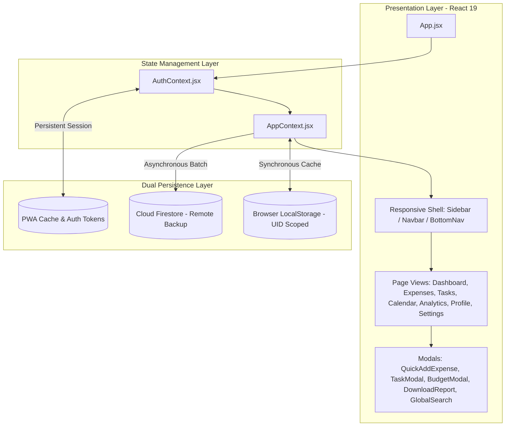
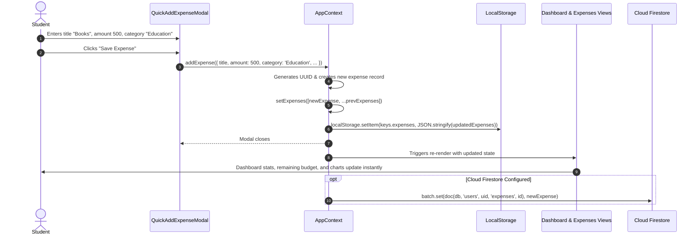

# CampusFlow – System Architecture & Technical Design

This document details the software architecture, design patterns, state management lifecycle, data flow pipelines, and performance optimizations implemented in **CampusFlow 2.1**.

---

## Table of Contents

1. [High-Level Architectural Overview](#1-high-level-architectural-overview)
2. [Component Hierarchy & Layout Architecture](#2-component-hierarchy--layout-architecture)
3. [State Management Architecture](#3-state-management-architecture)
4. [Unidirectional Data Flow Lifecycle](#4-unidirectional-data-flow-lifecycle)
5. [Storage Layer & LocalStorage Key Schema](#5-storage-layer--localstorage-key-schema)
6. [Offline-First Strategy & PWA Service Worker](#6-offline-first-strategy--pwa-service-worker)
7. [Performance Optimizations & Best Practices](#7-performance-optimizations--best-practices)

---

## 1. High-Level Architectural Overview

CampusFlow is built as a single-page client-side web application (SPA) using **React 19**, bundled and optimized with **Vite 8**, styled with **Tailwind CSS v4**, and backed by **Firebase Auth & Cloud Firestore**.

The architectural core follows three foundational principles:
1. **Offline-First Persistence**: All user operations (adding expenses, toggling tasks, altering budgets) are immediately committed to browser-local storage with zero network latency.
2. **Decoupled Cloud Synchronization**: Cloud interactions (Firebase Auth and Firestore synchronization) operate asynchronously without blocking UI interactions.
3. **Adaptive Modular UI**: Layout dynamically adapts between a persistent multi-column desktop environment (`≥768px`) and an application-grade mobile experience (`<768px`) featuring a 5-tab bottom bar and bottom drawer.



---

## 2. Component Hierarchy & Layout Architecture

The user interface follows a clear hierarchical composition:

```
src/
├── main.jsx                     (Root entry point, mounts to #root)
├── App.jsx                      (Top-level container, ErrorBoundary, AuthProvider, AppProvider)
├── context/
│   ├── AuthContext.jsx          (Firebase Auth state, signup, login, logout, resetPassword)
│   └── AppContext.jsx           (Expenses, Tasks, Budget, Profile, Preferences, Toast, ActivePage)
├── components/
│   ├── Sidebar.jsx              (Desktop persistent sidebar - 232px)
│   ├── Navbar.jsx               (Desktop & Mobile top navigation bar, page titles, quick search, avatar)
│   ├── BottomNav.jsx            (Mobile bottom navigation bar - 5 primary tabs)
│   ├── MobileMoreDrawer.jsx     (Mobile sheet drawer for Analytics, Profile, Settings, Logout)
│   ├── QuickAddExpenseModal.jsx (Expense creation and edit modal)
│   ├── TaskModal.jsx            (Task creation and priority configuration)
│   ├── BudgetModal.jsx          (Monthly spending limit configurator)
│   ├── DownloadReportModal.jsx  (PDF generator dialog with month/year selector)
│   ├── GlobalSearchModal.jsx    (Spotlight/Omnibar search modal with Ctrl+K shortcut)
│   ├── UserAvatar.jsx           (Reusable avatar component with fallback initials)
│   ├── Toast.jsx                (Global feedback alerts and notifications)
│   ├── ErrorBoundary.jsx        (Component crash isolation with fallback UI)
│   ├── PWAInstallBanner.jsx     (PWA install prompt banner)
│   └── PWAStatus.jsx            (Offline status indicator)
└── views/
    ├── DashboardView.jsx        (Financial overview, stats, recent list, urgent tasks)
    ├── ExpenseView.jsx          (Full expenses list, filter bar, category breakdowns)
    ├── TodoView.jsx             (Task lists, priority filters, confetti trigger)
    ├── CalendarView.jsx         (Monthly calendar grid, expense markers, day drawer)
    ├── AnalyticsView.jsx        (Doughnut & Bar charts, spending breakdown, insights)
    ├── ProfileView.jsx          (User avatar, personal info, authentication status, security)
    ├── SettingsView.jsx         (Currency, date format, theme toggle, JSON backup/restore)
    └── AuthView.jsx             (Sign in, Sign up, Forgot password cards)
```

### 2.1 Viewport Breakpoints & Responsive Strategy

| Breakpoint | Target Devices | Navigation Shell | Content Layout |
| :--- | :--- | :--- | :--- |
| `< 768px` | Mobile (iPhone, Galaxy, Pixel) | Sticky top `Navbar` + Fixed bottom `BottomNav` (5 tabs) + `MobileMoreDrawer` | Single-column, stacked cards, full-width touch-friendly modals |
| `768px - 1024px` | Tablets & iPads | Fixed 232px `Sidebar` + Top `Navbar` | 2-column responsive grid |
| `≥ 1024px` | Laptops & Desktops | Fixed 232px `Sidebar` + Top `Navbar` | 3-column / 4-column balanced grid, modal dialogs centered with backdrop blur |

---

## 3. State Management Architecture

CampusFlow utilizes the **React Context API** for global state management, avoiding heavy third-party dependencies while guaranteeing clean separation of concerns.

### 3.1 AuthContext (`src/context/AuthContext.jsx`)
- **State**:
  - `currentUser`: The active Firebase User object containing `uid`, `email`, `displayName`, and `photoURL`.
  - `loading`: Boolean flag indicating if the initial auth session is being restored.
  - `authError`: String containing friendly error messages.
  - `isFirebaseConfigured`: Boolean flag checking presence of environment variables.
- **Actions Exposed**:
  - `signup(email, password, displayName)`
  - `login(email, password)`
  - `logout()`
  - `resetPassword(email)`
  - `updateUserProfile({ displayName, photoURL })`
  - `updateUserPassword(newPassword)`
  - `deleteUserAccount()`

### 3.2 AppContext (`src/context/AppContext.jsx`)
- **State**:
  - `expenses`: Array of expense objects (`[{ id, title, amount, category, date, paymentMethod, notes }]`).
  - `monthlyBudget`: Numeric monthly ceiling (e.g., `10000`).
  - `todos`: Array of task objects (`[{ id, title, priority, dueDate, completed }]`).
  - `profile`: User configuration (`{ name, avatarUrl, theme, isOnboarded }`).
  - `preferences`: Localization settings (`{ currency, dateFormat, firstDayOfWeek, defaultCategory }`).
  - `activePage`: Active view identifier (`'dashboard'`, `'expenses'`, `'todos'`, `'calendar'`, `'analytics'`, `'profile'`, `'settings'`).
  - `toast`: Global alert object (`{ show: boolean, message: string, type: 'success' | 'error' | 'info' }`).
- **Actions Exposed**:
  - `addExpense(data)`, `editExpense(id, data)`, `deleteExpense(id)`
  - `setMonthlyBudget(number)`
  - `addTodo(data)`, `toggleTodo(id)`, `deleteTodo(id)`
  - `updateProfile(data)`
  - `updatePreferences(data)`
  - `exportData()`, `importData(jsonData)`, `clearAllData()`
  - `showToast(message, type)`

---

## 4. Unidirectional Data Flow Lifecycle

Data flows predictably through user interaction, local state dispatch, storage caching, and UI reconciliation:



---

## 5. Storage Layer & LocalStorage Key Schema

To protect student privacy and avoid multi-user collision on shared computers, storage keys are dynamically prefixed with the active Firebase `uid`.

### 5.1 Storage Schema Definition

```javascript
// Storage key resolver in src/context/AppContext.jsx
const getUserStorageKeys = (uid) => {
  if (!uid) {
    return {
      profile: 'campusflow_profile_v2',
      expenses: 'campusflow_expenses_v2',
      budget: 'campusflow_budget_v2',
      todos: 'campusflow_todos_v2',
      categories: 'campusflow_categories_v2',
      preferences: 'campusflow_preferences_v2',
      migrated: 'campusflow_migrated_v2',
    };
  }
  return {
    profile: `campusflow_${uid}_profile`,
    expenses: `campusflow_${uid}_expenses`,
    budget: `campusflow_${uid}_budget`,
    todos: `campusflow_${uid}_todos`,
    categories: `campusflow_${uid}_categories`,
    preferences: `campusflow_${uid}_preferences`,
    migrated: `campusflow_${uid}_migrated`,
  };
};
```

### 5.2 LocalStorage Data Structures

| Key Pattern | Data Type | Stored Data Schema |
| :--- | :--- | :--- |
| `campusflow_${uid}_profile` | JSON Object | `{"name": "Alex", "avatarUrl": "data:image/png...", "theme": "dark", "isOnboarded": true}` |
| `campusflow_${uid}_expenses` | JSON Array | `[{"id": "exp_1", "title": "Mess", "amount": 2500, "category": "Food", "date": "2026-11-14"}]` |
| `campusflow_${uid}_budget` | String / Number | `"7500"` |
| `campusflow_${uid}_todos` | JSON Array | `[{"id": "todo_1", "title": "Submit Lab Report", "priority": "High", "dueDate": "2026-11-15", "completed": false}]` |
| `campusflow_${uid}_preferences`| JSON Object | `{"currency": "INR", "dateFormat": "DD/MM/YYYY", "firstDayOfWeek": "Monday", "themeMode": "dark"}` |

---

## 6. Offline-First Strategy & PWA Service Worker

CampusFlow is configured as a Progressive Web Application (PWA) using `vite-plugin-pwa`.

### 6.1 Web App Manifest (`public/manifest.json`)
- Configured with `display: "standalone"`, `start_url: "/"`, `theme_color: "#1F4D3A"`, and `background_color: "#FBF9F4"`.
- Provides 192x192 and 512x512 maskable application icons.
- Enables desktop and mobile users to "Install" CampusFlow as a native standalone app.

### 6.2 Service Worker Caching Strategies
- **App Shell & Static Assets**: Cached using a `CacheFirst` strategy (HTML, JS bundles, CSS, Google Fonts, Lucide SVGs).
- **Client Offline Status**: `PWAStatus.jsx` listens to `navigator.onLine` and `window.addEventListener('online' / 'offline')` to render a subtle banner informing users of connection state.
- **Update Prompt**: `PWAUpdater.jsx` prompts users when a new production bundle has been deployed on Vercel without breaking current user forms.

---

## 7. Performance Optimizations & Best Practices

1. **Lightweight Bundle Architecture**:
   - Zero heavyweight UI component libraries. Built natively with Tailwind CSS v4 design tokens and Lucide React icons.
   - Vite 8 tree-shaking ensures only imported functions from `firebase/auth` and `firebase/firestore` are bundled.
2. **Memoization & Re-render Prevention**:
   - Heavy financial calculations (category aggregation, burn rate, monthly sums) are wrapped in `useMemo` hooks.
   - Event handlers passed to list items are wrapped with `useCallback` to prevent unnecessary component invalidation.
3. **Client-Side PDF Generation**:
   - `jsPDF` and `jspdf-autotable` run entirely inside the client browser thread, avoiding expensive server-side headless browser rendering infrastructure.
4. **SVG Iconography**:
   - Crisp SVG rendering via `lucide-react` with minimal DOM overhead.
